# ⚡ Awesome Network Wake-On-LAN & Wireless Utilities 📶

<div align="center">

<a href="https://github.com/ishandutta2007/Awesome-Network-Wake-On-Lan-Wireless-Utilities">
  
</a>

<br/>

<a href="https://github.com/ishandutta2007/Awesome-Awesome-Awesome"></a>
<a href="https://discord.gg/jc4xtF58Ve"></a>
<a href="https://github.com/ishandutta2007/Awesome-Network-Wake-On-Lan-Wireless-Utilities/stargazers"></a>
<a href="https://github.com/ishandutta2007/Awesome-Network-Wake-On-Lan-Wireless-Utilities/network/members"></a>
<a href="https://github.com/ishandutta2007/Awesome-Network-Wake-On-Lan-Wireless-Utilities/issues"></a>
<a href="https://github.com/ishandutta2007/Awesome-Network-Wake-On-Lan-Wireless-Utilities/blob/main/LICENSE"></a>
<a href="https://github.com/ishandutta2007"></a>

<br/>

**A comprehensively curated collection of top SaaS products, enterprise RMM solutions, out-of-band IP-KVM controllers, and open-source utilities for Wake-on-LAN (WoL), Wake-on-Wireless-LAN (WoWLAN), Bluetooth proximity boot, and remote server power automation.**

</div>

---

## 📑 Table of Contents

- [🌐 Sector Overview & Market Dynamics](#-sector-overview--market-dynamics)
- [🏢 SaaS & Commercial Remote Power Management Platforms](#-saas--commercial-remote-power-management-platforms)
- [🔓 Top Open-Source Projects & Utilities](#-top-open-source-projects--utilities)
  - [Hardware & Out-of-Band Power Management](#-hardware--out-of-band-power-management)
  - [Zero-Trust Mesh Relays & Remote Subnet Access](#-zero-trust-mesh-relays--remote-subnet-access)
  - [Full-Stack Remote Access & Self-Hosted RMM](#-full-stack-remote-access--self-hosted-rmm)
  - [Web Dashboards, Schedulers & Standalone WOL Daemons](#-web-dashboards-schedulers--standalone-wol-daemons)
- [🛠️ Protocol Architecture & Deployment Reference](#-protocol-architecture--deployment-reference)
- [🤝 How to Contribute](#-how-to-contribute)
- [💖 Support & Sponsorship](#-support--sponsorship)
- [📈 Star History](#-star-history)
- [⚠️ Disclaimer](#️-disclaimer)

---

## 🌐 Sector Overview & Market Dynamics

The global Remote Monitoring and Management (RMM), Unified Endpoint Management (UEM), and remote computer access market was valued at approximately **$4.8 billion in 2024** and is projected to expand to **over $12.5 billion by 2032** at an estimated CAGR of 12.8%. 

The enterprise and commercial segment displays **moderate consolidation** dominated by prominent multi-billion dollar platform providers (such as NinjaOne, GoTo/LogMeIn, SolarWinds, and ManageEngine) competing alongside public market leaders like TeamViewer. However, the ecosystem remains **highly fragmented across self-hosted, homelab, and edge environments**, where emerging hardware standards (e.g., PiKVM, NanoKVM, JetKVM) and Zero-Trust WireGuard mesh overlay networks (Tailscale, NetBird) continuously challenge legacy proprietary vendor lock-in.

---

## 🏢 SaaS & Commercial Remote Power Management Platforms

*Sorted by Company Revenue / Valuation (Descending)*

| Platform / Vendor | Company Scale (Revenue / Valuation) | Starting Pricing (Specific Tier) | Free Tier / Trial Limit | Key Remote Power & WoL Capabilities |
| :--- | :--- | :--- | :--- | :--- |
| **[SolarWinds Dameware Remote Everywhere](https://dameware.com)** | **$785M+ annual revenue** *(NASDAQ: SWI)* | **$43.25/month** ($519 billed annually per concurrent tech) | **14-day free trial** with full access to all remote control, WoL, and diagnostic tools (no credit card required) | Enterprise Intel vPro AMT out-of-band hardware power control, centralized Wake-on-LAN magic packet routing across subnets, and Active Directory authentication. |
| **[TeamViewer Remote](https://teamviewer.com)** | **$710M+ (€672M) revenue** / ~$2.8B market cap *(ETR: TMV)* | **$24.90/month** ($298.80 billed annually for Single User) | **Free forever plan** strictly for non-commercial personal use (connect to up to 3 managed endpoints) | Built-in Wake-on-LAN relaying through other online master machines on the local network subnet, Wake-on-WAN through public router port forwarding, and 256-bit AES encryption. |
| **[GoTo Resolve (LogMeIn Central)](https://goto.com)** | **$1.3B+ revenue** *(Valuation: ~$4B, Francisco Partners & Evergreen)* | **$59/month** ($708 billed annually for 25 managed devices) | **Free forever plan** for up to 3 managed devices; or a **14-day free trial** of commercial tier without credit card | Cloud-managed Wake-on-LAN via peer agent broadcasting, zero-trust endpoint access architecture, remote background command-line terminal, and multi-platform automation scripts. |
| **[ManageEngine Endpoint Central](https://manageengine.com)** | **Division of Zoho Corp** ($1B+ ARR, $10B+ bootstrapped valuation) | **$795/year** for Professional Edition (starts at 50 computers) | **Free forever plan** for up to 25 computers and 25 mobile devices with full endpoint power/patching management | Centralized scheduled Wake-on-LAN tasks, batch machine waking prior to patch management windows, bandwidth-optimized subnet broadcasting, and comprehensive power audits. |
| **[NinjaOne](https://ninjaone.com)** | **$1.9B valuation** (Series C led by Iconiq Growth; $150M+ ARR) | **~$3.00/device/month** (custom-quoted MSP minimum tiers starting at ~$200/month) | **14-day free trial** with full platform capabilities across 50 endpoints (dedicated sandbox instance) | Cloud-native RMM enabling single-click Wake-on-LAN from ninja-agent peers on the target subnet, automated patch-window machine wake orchestration, and scheduled server reboot recipes. |
| **[AnyDesk](https://anydesk.com)** | **~$660M valuation** (Series C led by General Atlantic; ~$70M ARR) | **$14.90/month** ($178.80 billed annually for Solo tier) | **Free forever plan** for strictly personal private use (1 outgoing connection, up to 3 devices) | Ultralow latency DeskRT codec with remote Wake-on-LAN triggering via neighboring active nodes on the same network subnet without requiring static public IPs. |
| **[Splashtop Business Access](https://splashtop.com)** | **$1B+ unicorn valuation** (backed by Sapphire Ventures & NEA) | **$5.00/month** ($60 billed annually per user for Solo, up to 2 computers) | **7-day free trial** with complete access to Wake-on-LAN, remote reboot, and dual-monitor remote viewing | Remote Wake-on-LAN triggered through other Windows/Mac machines running Splashtop Streamer on the same LAN, one-click remote reboot into safe mode, and high-framerate 4K display. |
| **[Atera](https://atera.com)** | **$500M valuation** (Series B led by General Atlantic; $50M+ ARR) | **$129/technician/month** (billed annually for Pro Plan) | **30-day free trial** with unlimited endpoints and full IT automation feature set (no credit card required) | All-in-one RMM and PSA suite featuring scripted network wake commands, network discovery scanning, automated server maintenance routines, and AI-driven automated ticket remediation. |
| **[Pulseway RMM](https://pulseway.com)** | **~$30M ARR** (Enterprise IT & MSP provider; bootstrapped/Kaseya backed) | **$27/month** (base tier covering 20 endpoints billed annually) | **14-day free trial** covering up to 5 servers/workstations with full mobile app remote power commands | Real-time native iOS/Android mobile dashboard allowing sysadmins to dispatch Wake-on-LAN packets, restart critical services, and remotely cycle physical server power on the go. |
| **[Depicus Wake on LAN](https://depicus.com)** | **Boutique software studio** (<$2M revenue, independent micro-ISV) | **$19.99 one-time purchase** for commercial GUI command line tools | **Free forever plan** for web browser magic packet sender (limited to 5 manual browser requests/hour) | Pioneering standard WoL utility suite since 2000, supporting custom UDP port routing (ports 7, 9, 3004), subnet masking, secure password-protected magic packets, and WoL monitor listeners. |

---

## 🔓 Top Open-Source Projects & Utilities

*Ranked strictly by GitHub Stars_Count (Descending). Stars_Badges link directly to the repository stargazers page.*

| Project | GitHub_Stars | Focus & Power Management Capabilities |
| :--- | :---: | :--- |
| **[RustDesk](https://github.com/rustdesk/rustdesk)** | <a href="https://github.com/rustdesk/rustdesk/stargazers"></a> | Premier open-source remote desktop client and server software written in Rust. Self-hosted alternative to TeamViewer with end-to-end encryption, multi-platform relay servers, and integrated Wake-on-LAN node triggering. |
| **[Home Assistant Core](https://github.com/home-assistant/core)** | <a href="https://github.com/home-assistant/core/stargazers"></a> | The world's leading open-source home automation system. Features native `wake_on_lan` switch integration, ESPHome BLE Bluetooth proximity proxies, and smart-plug power-cycle failovers for headless server management. |
| **[Sunshine](https://github.com/SunshineStream/Sunshine)** | <a href="https://github.com/SunshineStream/Sunshine/stargazers"></a> | Self-hosted, low-latency game and remote desktop streaming server for Moonlight. Includes automatic Wake-on-LAN packet dispatch and power-saving sleep triggers for high-end workstation streaming. |
| **[Tailscale](https://github.com/tailscale/tailscale)** | <a href="https://github.com/tailscale/tailscale/stargazers"></a> | Zero-config WireGuard mesh VPN. Enables users to securely route UDP Magic Packets into remote private subnets without exposing open ports or unencrypted WAN routers to the internet. |
| **[NetBird](https://github.com/netbirdio/netbird)** | <a href="https://github.com/netbirdio/netbird/stargazers"></a> | Open-source Zero-Trust WireGuard overlay network platform. Allows administrators to configure subnet routers and trigger authenticated Wake-on-LAN broadcasts into isolated physical LANs remotely. |
| **[Moonlight Qt](https://github.com/moonlight-stream/moonlight-qt)** | <a href="https://github.com/moonlight-stream/moonlight-qt/stargazers"></a> | High-performance open-source game streaming client. Features built-in Wake-on-LAN packet generation upon selecting a sleeping host computer across local network and remote VPN tunnels. |
| **[PiKVM](https://github.com/pikvm/pikvm)** | <a href="https://github.com/pikvm/pikvm/stargazers"></a> | Revolutionary open-source DIY KVM-over-IP platform based on Raspberry Pi. Provides true out-of-band ATX motherboard power button switching, reset relay controls, virtual ISO mounting, and BIOS access when WoL fails. |
| **[MeshCentral](https://github.com/Ylianst/MeshCentral)** | <a href="https://github.com/Ylianst/MeshCentral/stargazers"></a> | Complete web-based remote computer management and endpoint operations server. Features hardware-level Intel AMT power control, Wake-on-LAN broadcasting, remote web terminals, and desktop control. |
| **[WatchYourLAN](https://github.com/aceberg/WatchYourLAN)** | <a href="https://github.com/aceberg/WatchYourLAN/stargazers"></a> | Lightweight open-source network IP and MAC scanner written in Go. Monitors online/offline host presence, generates notifications on state changes, and links directly with homelab dashboard wake actions. |
| **[NetAlertX](https://github.com/netalertx/NetAlertX)** | <a href="https://github.com/netalertx/NetAlertX/stargazers"></a> | Enterprise-grade network device scanner (formerly Pi.Alert). Detects new and offline Wi-Fi/Ethernet devices, alerts on rogue MAC addresses, and supports webhook triggers for automatic Wake-on-LAN. |
| **[NanoKVM](https://github.com/sipeed/NanoKVM)** | <a href="https://github.com/sipeed/NanoKVM/stargazers"></a> | Compact, ultra-affordable RISC-V IP-KVM hardware and software. Provides hardware ATX power/reset pin controls, HDMI loop capture, Tailscale zero-tier integration, and responsive browser management. |
| **[UpSnap](https://github.com/seriousm4x/UpSnap)** | <a href="https://github.com/seriousm4x/UpSnap/stargazers"></a> | Modern open-source Wake-on-LAN web application built with SvelteKit, Go, and PocketBase. Features automatic device network scanning, scheduled cron waking, ping status tracking, and multi-user access permissions. |
| **[JetKVM](https://github.com/jetkvm/kvm)** | <a href="https://github.com/jetkvm/kvm/stargazers"></a> | Modern ultra-compact KVM-over-IP hardware and software system. Delivers browser-based low-latency BIOS control, ATX power button switching, and remote recovery without requiring cloud relays. |
| **[Tactical RMM](https://github.com/amidaware/tacticalrmm)** | <a href="https://github.com/amidaware/tacticalrmm/stargazers"></a> | Comprehensive open-source remote monitoring and management platform built on Django, Vue, and Go. Features automated Wake-on-LAN scripts, remote command line, patch deployment, and mesh agent integration. |
| **[Apache Guacamole Server](https://github.com/apache/guacamole-server)** | <a href="https://github.com/apache/guacamole-server/stargazers"></a> | Clientless HTML5 remote desktop gateway daemon. Supports automatic transmission of Wake-on-LAN magic packets to waking destination workstations prior to initializing RDP, VNC, or SSH connections. |
| **[Remmina](https://github.com/FreeRDP/Remmina)** | <a href="https://github.com/FreeRDP/Remmina/stargazers"></a> | The quintessential GTK+ remote desktop client for Linux and Unix desktops. Features a dedicated Wake-on-LAN plugin that automatically sends UDP magic packets before establishing remote sessions. |
| **[WakeOnLAN GUI](https://github.com/basildane/WakeOnLAN)** | <a href="https://github.com/basildane/WakeOnLAN/stargazers"></a> | Established open-source Windows desktop application. Offers full-featured subnet broadcasting, ping-based reachability checks, scheduled shutdown, emergency reboots, and multi-adapter selection. |
| **[Trugamr / wol](https://github.com/Trugamr/wol)** | <a href="https://github.com/Trugamr/wol/stargazers"></a> | Fast, single-binary cross-platform CLI and web-based Wake-on-LAN utility. Wakes machines via simple commands, REST endpoints, or a clean responsive browser interface across local subnets. |
| **[Sleep-On-LAN](https://github.com/SR-G/sleep-on-lan)** | <a href="https://github.com/SR-G/sleep-on-lan/stargazers"></a> | Multi-platform daemon for Linux and Windows allowing remote suspend, hibernate, or shutdown through reverse magic packets, HTTP REST requests, and custom remote triggers. |
| **[go-wol](https://github.com/sabhiram/go-wol)** | <a href="https://github.com/sabhiram/go-wol/stargazers"></a> | Ultra-lightweight, zero-dependency Go package and CLI command for constructing and broadcasting RFC-compliant Wake-on-LAN magic packets across custom broadcast interfaces. |
| **[Florianisme / WakeOnLan](https://github.com/Florianisme/WakeOnLan)** | <a href="https://github.com/Florianisme/WakeOnLan/stargazers"></a> | Privacy-centric open-source Android Wake-on-LAN client. Supports home screen launcher widgets, tasker automation plugins, CSV device import/export, and secure LAN broadcasting. |
| **[wolweb](https://github.com/sameerdhoot/wolweb)** | <a href="https://github.com/sameerdhoot/wolweb/stargazers"></a> | Lightweight web interface and REST service written in Go for triggering Wake-on-LAN packets. Features device MAC storage and clean Bootstrap UI suited for Raspberry Pi servers. |
| **[jpoliv / wakeonlan](https://github.com/jpoliv/wakeonlan)** | <a href="https://github.com/jpoliv/wakeonlan/stargazers"></a> | Classic, battle-tested Perl utility found in Debian, Ubuntu, and Red Hat package managers for constructing and transmitting raw Layer-2 Ethernet and UDP Magic Packets. |
| **[RallyUp](https://github.com/darwindarak/rallyup)** | <a href="https://github.com/darwindarak/rallyup/stargazers"></a> | Modern lightweight Wake-on-LAN scheduler and dependency manager for homelab operators. Enables sequential startup of storage, database, and application nodes upon power restoration. |

---

### 🗂️ Categorized Open-Source Deep Dives

#### 🔌 Hardware & Out-of-Band Power Management
When an operating system crashes, freezes, or standard Wake-on-LAN fails due to deep C-state power saving (`S5` state without standby PCIe power), hardware-level KVMs provide physical power button actuation:
- **[PiKVM](https://github.com/pikvm/pikvm)**: The community gold standard for DIY Raspberry Pi 4 KVM-over-IP with optocoupler relay control for ATX power and reset switches.
- **[NanoKVM](https://github.com/sipeed/NanoKVM)**: RISC-V PCIe or thumb-sized IP-KVM with ATX power jumper headers and integrated Tailscale VPN.
- **[JetKVM](https://github.com/jetkvm/kvm)**: Compact commercial-grade open-source IP-KVM with native video capture and power cycle switches.

#### 🛡️ Zero-Trust Mesh Relays & Remote Subnet Access
Because raw Wake-on-LAN packets use non-routable Layer-2 broadcast frames (`255.255.255.255` or subnet directed `192.168.1.255`), secure overlay networks enable sending packets to remote subnets without firewall risk:
- **[Tailscale Subnet Routers](https://github.com/tailscale/tailscale)**: Route internal UDP `7`/`9` traffic across encrypted WireGuard tunnels without exposing WAN ports.
- **[NetBird Subnet Peers](https://github.com/netbirdio/netbird)**: Identity-based peer-to-peer overlay network with custom access control policies for WoL scripts.

#### 🖥️ Full-Stack Remote Access & Self-Hosted RMM
- **[RustDesk](https://github.com/rustdesk/rustdesk)**: Self-host your own ID/relay servers and wake client endpoints securely.
- **[MeshCentral](https://github.com/Ylianst/MeshCentral)**: Supports Intel AMT (vPro) hardware out-of-band power and wake orchestration.
- **[Tactical RMM](https://github.com/amidaware/tacticalrmm)**: Full MSP-grade remote agent with automated script runners and scheduled network wakeups.

#### 🎛️ Web Dashboards, Schedulers & Standalone WOL Daemons
- **[UpSnap](https://github.com/seriousm4x/UpSnap)**: Containerized web app with ping health checks, scheduled wake times, and device discovery.
- **[Sleep-On-LAN](https://github.com/SR-G/sleep-on-lan)**: Bidirectional power management—send sleep commands when servers complete nightly backups.
- **[WatchYourLAN](https://github.com/aceberg/WatchYourLAN)** & **[NetAlertX](https://github.com/netalertx/NetAlertX)**: Real-time network presence monitoring with alerting and WoL triggers.

---

## 🛠️ Protocol Architecture & Deployment Reference

### ⚡ The Magic Packet Anatomy
A standard Wake-on-LAN Magic Packet is an unauthenticated broadcast frame containing an arbitrary payload of **6 bytes of all 255 (`0xFFFFFFFFFFFF`) followed by 16 repetitions of the target device's 48-bit MAC address**:

```text
[ Ethernet Header (Layer 2) ]
Destination MAC: FF:FF:FF:FF:FF:FF (Broadcast)
Source MAC:      Sender Network Adapter MAC
EtherType:       0x0800 (IPv4)

[ IP Header (Layer 3) ]
Destination IP:  255.255.255.255 (Global Broadcast) or 192.168.x.255 (Subnet Broadcast)
Protocol:        UDP (17)

[ UDP Header (Layer 4) ]
Destination Port: 7 (Echo) or 9 (Discard)

[ Magic Packet Payload (Layer 7 / Application) ]
Synchronization Stream: FF FF FF FF FF FF
MAC Repetitions (16x):  [MAC] [MAC] [MAC] ... [MAC]  (e.g., 00:11:22:33:44:55 x 16 = 96 bytes)
Optional SecureOn Pass: 4 or 6 bytes password (supported by select enterprise NICs)
```

### 🔧 Linux System Configuration
To enable Magic Packet wake reception on Linux system interfaces, configure `ethtool` and verify ACPI power states:

```bash
# 1. Inspect NIC WoL capability
sudo ethtool eth0 | grep "Wake-on"
# Supports: pumbg (g = magic packet)
# Wake-on: d (disabled) or g (enabled)

# 2. Enable Magic Packet reception
sudo ethtool -s eth0 wol g

# 3. Make persistent across reboots via systemd-networkd or NetworkManager
sudo nmcli connection modify "Wired connection 1" 802-3-ethernet.wake-on-lan magic
```

---

## 🤝 How to Contribute

Contributions are welcome! Help build the definitive guide to remote power automation and wireless network utilities:

1. **Fork the repository** on GitHub.
2. **Add or update an entry** in `README.md` following the tabular or categorized structure.
3. **Verify criteria**: Provide accurate pricing, trial specifications, GitHub repository star links, and factual technical descriptions.
4. **Submit a Pull Request** with a concise description of your additions.

For details on awesome lists, please explore [Awesome-Awesome-Awesome](https://github.com/ishandutta2007/Awesome-Awesome-Awesome).

---

## 💖 Support & Sponsorship

If this curated ecosystem helps automate your homelab, simplify enterprise endpoint management, or keep your remote systems accessible, consider supporting ongoing research and maintenance!

- 🌟 **Star the repository** to boost visibility on GitHub.
- 🍴 **Fork the project** and share it with your network engineering and DevOps communities.
- ☕ **Buy a coffee & sponsor development**: Visit the **[GitHub Sponsors Dashboard](https://github.com/sponsors/ishandutta2007)** to support future updates and open-source tooling projects!

---

## 📈 Star History

#[](https://star-history.dera.page/#ishandutta2007/Awesome-Network-Wake-On-Lan-Wireless-Utilities&type=date&legend=top-left)
[](https://www.star-history.com/#ishandutta2007/Awesome-Network-Wake-On-Lan-Wireless-Utilities&type=date&legend=top-left)

---

## ⚠️ Disclaimer

- This repository is a community-curated technical directory and does not constitute an explicit commercial endorsement of any software or hardware product.
- **Security Best Practice**: Wake-on-LAN packets are unencrypted by design. Never route unauthenticated UDP ports `7` or `9` directly across the public internet. Always deliver Magic Packets via an authenticated Zero-Trust VPN tunnel (e.g., Tailscale, NetBird, WireGuard) or an authenticated internal gateway (UpSnap, MeshCentral).
- Wake-on-Wireless-LAN (WoWLAN) and Wake-on-Bluetooth require hardware adapter, BIOS/UEFI firmware, and OS ACPI power-state compatibility.
